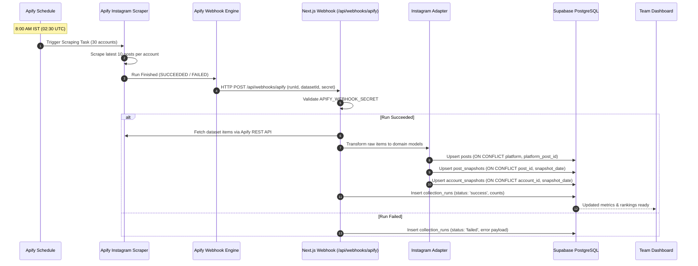
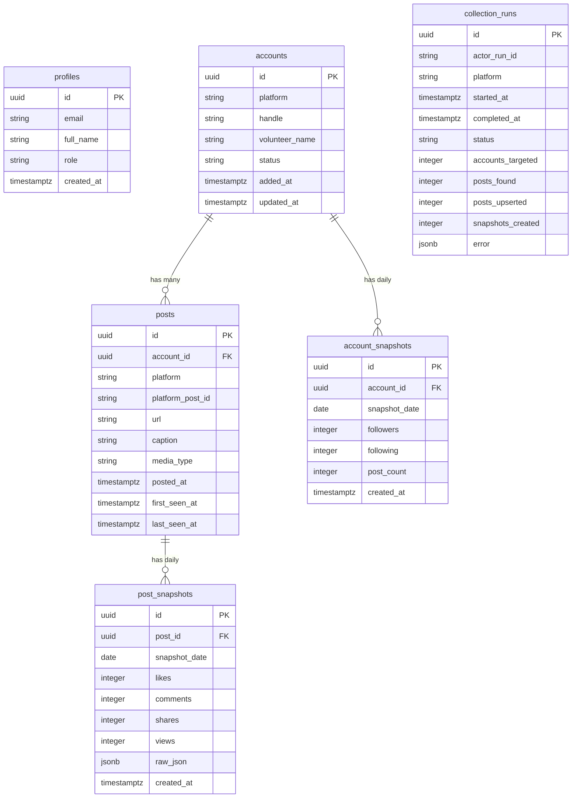

# Social Media Engagement Monitoring System - Architecture Documentation

**Architecture Status**: LOCKED  
**Last Updated**: November 2026

---

## 1. Executive Summary

The Social Media Engagement Monitoring System is an automated, web-based analytics platform designed to monitor, analyze, and visualize daily engagement across monitored volunteer social media accounts.

The architecture is locked to a modern, decoupled stack combining Next.js on Vercel for the web application and API layer, Supabase PostgreSQL for persistent storage and authentication, and Apify for data scraping, automated scheduling, and event-driven webhooks.

---

## 2. Technology Stack & Component Responsibilities

| Component | Technology | Primary Responsibility |
|---|---|---|
| **Frontend Framework** | Next.js 14+ (App Router) | Server-rendered pages, client-side interactivity, authenticated routing |
| **Language** | TypeScript (Strict Mode) | End-to-end type safety, zero `any` types, strict null checks |
| **Design System** | Tailwind CSS + shadcn/ui | Clean, modern UI components, responsive layout |
| **Data Visualization** | Recharts | Interactive time-series charts, delta graphs, ranking distributions |
| **Relational Database** | Supabase PostgreSQL | Normalized storage, unique constraints, and SQL aggregation views |
| **Authentication** | Supabase Auth | Team member login, JWT session verification, Row Level Security (RLS) |
| **Scraper** | Apify Instagram Scraper | Anti-bot handling, residential proxies, profile and post extraction |
| **Scheduler** | Apify Schedules | Independent daily execution at 8:00 AM IST (02:30 UTC) |
| **Data Handoff** | Apify Webhooks | Event-driven HTTP POST callback to Next.js API upon run completion |
| **Hosting Platform** | Vercel | Global CDN, edge routing, serverless compute, public HTTPS |

---

## 3. High-Level Architecture Diagram

```mermaid
flowchart TD
    subgraph Apify Cloud ["Apify Cloud Infrastructure"]
        AS[Apify Schedule<br/>Daily 8:00 AM IST] -->|Triggers| AT[Apify Instagram Scraper Task]
        AT -->|Scrapes (30 accounts, 10 posts)| AD[(Apify Dataset)]
        AT -->|On Run Completion| AW[Apify Webhook Engine]
    end

    subgraph Vercel ["Vercel Production Environment (HTTPS)"]
        AW -->|POST /api/webhooks/apify<br/>with Secret Header| WH[Next.js Webhook Handler]
        WH -->|1. Verify Secret| SEC[Signature Verifier]
        WH -->|2. Fetch Dataset Records| AD
        WH -->|3. Normalize Payload| ADP[Instagram Adapter<br/>lib/collectors/instagram.ts]
        ADP -->|4. Idempotent Upsert| ING[Ingestion Service]
        
        MW[Next.js Middleware<br/>Auth Guard] -->|Protects| DASH[Team Dashboard<br/>Next.js App Router]
        DASH -->|Recharts| VIZ[Visualizations & Volunteer Rankings]
    end

    subgraph Supabase ["Supabase Managed Cloud"]
        ING -->|Upsert Posts & Snapshots| DB[(PostgreSQL Database)]
        ING -->|Record Audit Log| CR[collection_runs]
        AUTH[Supabase Auth] -->|Verify Session & JWT| MW
        DB -->|SQL Views / Deltas| DASH
    end

    subgraph Users ["Team Members (Multiple Networks)"]
        TM1[Team Member - Office] -->|HTTPS Login| Vercel
        TM2[Team Member - Remote] -->|HTTPS Login| Vercel
    end
```

---

## 4. Daily Automation & Ingestion Workflow

Daily collection is fully decoupled from the application server. The application does not maintain cron jobs or polling loops.



### Automation Workflow Steps:
1. **Trigger**: Apify Schedule initiates the Instagram Scraping Task daily at 8:00 AM IST.
2. **Scrape**: Scrapes up to 10 recent posts from each active monitored account.
3. **Notification**: Upon run completion, Apify sends a webhook POST to `/api/webhooks/apify`.
4. **Validation & Retrieval**: The endpoint authenticates the webhook secret/signature and retrieves the dataset using the Apify server-side SDK.
5. **Normalization**: Raw vendor payloads are transformed into internal domain structures via `lib/collectors/instagram.ts`.
6. **Post Upsert**: Monitored posts are upserted into the `posts` table (inserting new posts and updating metadata for existing ones).
7. **Snapshot Upsert**: Engagement snapshots are saved into `post_snapshots` and `account_snapshots` for the current snapshot date.
8. **Audit Log**: Ingestion results, metrics count, and execution time are logged in `collection_runs`.
9. **Dashboard Presentation**: Updated analytics, rankings, and deltas are immediately reflected in the dashboard.

---

## 5. Hosting & Multi-Network Access

- **Hosting Provider**: Vercel.
- **Global Team Access**: The application is accessible from any standard web browser over HTTPS. Team members can securely log in from home, office, or field locations across different ISPs and cellular networks.
- **Access Protection**:
  - The entire dashboard is private and protected by Supabase Auth.
  - Next.js middleware guards all authenticated routes (`/dashboard/*`, `/accounts/*`, `/posts/*`, `/analytics/*`, `/settings/*`).
  - Unauthenticated users are redirected to `/login`.
- **Architectural Exclusions**:
  - Localhost hosting, Tailscale mesh networks, or VPN prerequisites are strictly excluded.
  - The application is a standard cloud-native web application deployed on Vercel.

---

## 6. Deprecated & Excluded Automation Architectures

The following automation mechanisms are **explicitly forbidden** and must not be introduced:

| Excluded Mechanism | Reason for Exclusion |
|---|---|
| **Netlify Cron Jobs** | Project is hosted on Vercel; Netlify services are not part of the stack. |
| **Vercel Cron Jobs** | Serverless function timeout limits (10s to 60s) risk truncating long-running scraping tasks. Scraping runs natively in Apify. |
| **Next.js In-Process Timers** | Serverless functions are ephemeral and do not sustain continuous background memory timers. |
| **External Cron Services** | Unnecessary external operational dependency. Apify Schedules is built into Apify at zero additional cost. |

---

## 7. Database Architecture & Schema Relationships



### Unique Constraints & Idempotency Rules:
- `posts`: `UNIQUE(platform, platform_post_id)` — Guarantees posts are never duplicated across repeated runs.
- `post_snapshots`: `UNIQUE(post_id, snapshot_date)` — Ensures at most one snapshot per post per calendar day; webhook retries update the existing daily snapshot.
- `account_snapshots`: `UNIQUE(account_id, snapshot_date)` — Ensures at most one account metrics snapshot per account per day.
- `profiles`: `id` references Supabase `auth.users(id)` with cascade delete.

---

## 8. Security & Secret Segregation

1. **Client vs Server Environment Variables**:
   - `NEXT_PUBLIC_SUPABASE_URL` and `NEXT_PUBLIC_SUPABASE_ANON_KEY` are the only variables exposed to the client bundle.
   - `SUPABASE_SERVICE_ROLE_KEY`, `APIFY_API_TOKEN`, and `APIFY_WEBHOOK_SECRET` are strictly server-side variables configured in Vercel and `.env.local`.
2. **Webhook Verification**:
   - Incoming webhook calls from Apify must supply and match `APIFY_WEBHOOK_SECRET` via header or signed payload parameter.
   - Requests failing verification are rejected immediately with HTTP 401 Unauthorized.
3. **Database Access**:
   - Row Level Security (RLS) is enabled on all PostgreSQL tables.
   - Webhook processing executes via the server-side Supabase client using the service-role key, bypassing RLS safely within server execution context.
   - Frontend operations interact via the authenticated user's session with RLS policies enforcing read/write permissions.

---

## 9. Data Integrity & Metric Normalization

- **Explicit `null` Representation**:
  - If a metric is hidden, unmeasured, or unavailable (such as hidden Instagram likes or private metrics), it is stored in the database as `null`.
  - Unavailable metrics are **never defaulted to `0`**.
  - In the dashboard, `null` renders as `"n/a"`, preserving accurate averages, engagement rates, and trend calculations.

---

## 10. Operational Scope & Cost Boundaries

- **Target Capacity (Phase 1)**: 30 active Instagram accounts.
- **Post Capture Window**: Up to 10 recent posts per active account.
- **Active Post Tracking**: Posts published within the last 30 days are tracked. Posts older than 30 days are frozen to control Apify compute usage.
- **Future Expansion (Phase 8)**: Facebook collection adapter and scaling to 1,000+ accounts.

