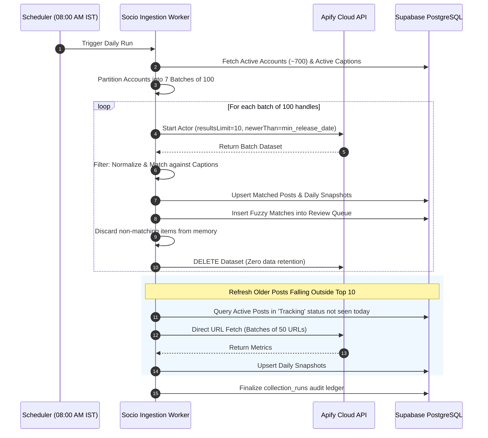
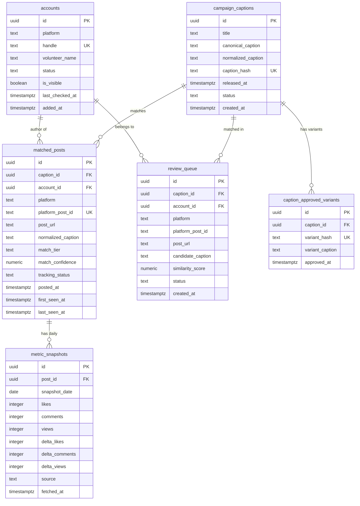

# Socio: Automated Social Media Content Tracking & Engagement Monitoring System
## Comprehensive System Audit, Redesign Architecture & Technical Specification

**Version:** 2.0.0 (Production Blueprint)  
**Status:** Approved Architecture Draft  
**Scope:** Release 1 (Instagram Primary) with Platform-Agnostic Core (Facebook & X Ready)  
**Author:** Senior Staff Engineer & Solutions Architect  
**Date:** November 2026  

---

## 1. Executive Summary & Core Product Context

### 1.1 Product Model
Socio is an automated volunteer monitoring platform designed to track whether volunteers (up to ~700 accounts) publish pre-approved campaign content to their personal public social accounts, and to monitor the point-in-time engagement (Likes, Comments, Views) generated by those posts over time.

### 1.2 The Fundamental Shift
- **Legacy Behavior**: Scraped volunteer accounts indiscriminately, persisting every personal photo, reel, and video into the database.
- **Redesigned Behavior**: **Track ONLY posts that correspond to official captions entered by admins.** Any post that does not match our pre-approved captions is discarded immediately in-memory and is never persisted to storage.

### 1.3 Key Operational Constraints & Decisions
1. **Caption-Only Entry**: Admins enter text captions through the dashboard. No media assets are uploaded or stored. Content takes effect on the next scheduled run.
2. **Admin-Only Platform**: Zero volunteer-facing interfaces. Volunteers do not log in, submit links, or interact with the platform.
3. **Single Daily Run**: Exactly **one comprehensive run executed daily** at 08:00 AM IST (02:30 UTC). No ad-hoc per-volunteer runs.
4. **Matching Hierarchy**: 
   - Tier 1: Exact Normalized-Caption Hash match (SHA-256).
   - Tier 2: Fuzzy similarity match ($\ge 90\%$) routed to an admin Review Queue with side-by-side visual diff.
   - Discard: Any post with $< 90\%$ similarity is discarded immediately.
5. **Metric Integrity**: 
   - Metrics tracked: **Likes**, **Comments**, and **Views** (no shares or private metrics).
   - Video/Reel views are captured; static image/carousel posts (which Instagram does not provide views for) are stored strictly as `null` (never `0`) and displayed as `"n/a"`.
6. **Platform Roadmap**:
   - **Release 1 (Now)**: Instagram only.
   - **Release 2**: Facebook (public personal accounts; requires validation spike).
   - **Release 3**: X (Twitter).
   - All data models, adapters, state machines, and UI components are strictly platform-agnostic with `platform` as a primary discriminator.

---

## 2. Phase 1: End-to-End System Audit

### 2.1 Architecture & Stack
- **Framework**: Next.js 14.2.18 (App Router), React 18.3.1, TypeScript 5.6.3 (Strict Mode enabled).
- **Styling & Visualization**: Tailwind CSS, Lucide Icons, Recharts 2.15.4.
- **Database**: Supabase PostgreSQL with `@supabase/supabase-js` (2.46.1) and `@supabase/ssr` (0.5.2).
- **Data Collection Engine**: Apify Cloud API (`apify-client` 2.11.4) running `apify/instagram-scraper`.
- **Hosting**: Vercel Cloud Platform with serverless compute and edge routing.
- **Security & Environment**: Zod-validated environment schema (`lib/env.ts`). Server-side secrets (`SUPABASE_SERVICE_ROLE_KEY`, `APIFY_API_TOKEN`, `APIFY_WEBHOOK_SECRET`) are never leaked to client bundles.

### 2.2 Data Ingestion Audit
In the legacy codebase (`lib/services/ingestion.ts` lines 111–171), the ingestion worker iterates through all posts returned by Apify without any filter:
```typescript
// LEGACY FLAW: Ingests every single post from volunteer feeds
for (const post of data.posts) {
  await supabase.from("posts").upsert({ ...post });
  await supabase.from("post_snapshots").upsert({ ...metrics });
}
```
This resulted in personal, private, and non-campaign posts being saved into persistent storage.

### 2.3 Data Model Audit
The legacy database schema defined 6 core tables:
- `accounts`: Monitored profiles (`platform`, `handle`, `volunteer_name`, `status`).
- `posts`: Platform post records (`account_id`, `platform_post_id`, `url`, `caption`, `media_type`).
- `post_snapshots`: Daily metric records (`post_id`, `snapshot_date`, `likes`, `comments`, `views`).
- `account_snapshots`: Daily account follower numbers.
- `collection_runs`: Audit trail for scraping jobs.
- `profiles`: Application team members linked to Supabase Auth.

**Deficiencies Identified**:
- Zero tables or concepts for campaign content, captions, or hashes.
- Zero assignment mapping between volunteers and content items.
- Platform check constraint in SQL restricted exclusively to `CHECK (platform IN ('instagram', 'facebook'))`, breaking compatibility with X/Twitter.
- Zero review queue for approving caption variations or typos.

### 2.4 Gap Analysis Matrix

| Requirement | Current Status | Relevant Files | Gap Description |
|---|---|---|---|
| **Filter Non-Campaign Content** | **MISSING** | `lib/services/ingestion.ts:111` | All scraped posts are persisted indiscriminately. |
| **Content Registry** | **MISSING** | None | No schema or UI for entering and managing campaign captions. |
| **Caption Normalization & Hashing** | **MISSING** | `lib/collectors/instagram.ts:75` | Captions stored as raw text without NFKC normalization or hashing. |
| **Two-Tier Matching Pipeline** | **MISSING** | None | No hash check or fuzzy matching algorithms exist. |
| **Single Daily Run Architecture** | **PARTIAL** | `lib/apify/trigger.ts:144` | Triggers all handles in one massive payload; lacks sharding and date boundaries. |
| **Tracked Posts Outside Recent 10** | **MISSING** | `lib/apify/trigger.ts:148` | Once a post drops off the top 10 recent feed, its engagement stops updating. |
| **Admin Matrix & Review Queue** | **MISSING** | None | Dashboard lacks volunteer-content matrix and caption diff review views. |
| **Public Visibility Detection** | **MISSING** | None | No detection or flagging of private/inaccessible volunteer accounts. |

---

## 3. Phase 2: Redesign Specification

### 3.1 High-Level Architecture

```mermaid
flowchart TD
    subgraph Admin ["Admin Workspace (Dashboard)"]
        CAP_IN[Admin Enters Canonical Caption] --> REG[(campaign_captions Table)]
        NOTE[Caption takes effect on next 08:00 AM IST run]
    end

    subgraph Scheduler ["Single Daily Run (08:00 AM IST)"]
        CRON[Apify Daily Schedule / Webhook] --> BATCH[Batch Sharder<br/>Chunks of 100 Handles]
        BATCH --> AP_FEED[Apify Scraper: Recent Posts<br/>newerThan = earliest release date]
        BATCH --> AP_DIRECT[Apify Scraper: Direct URL Fetch<br/>For active tracked posts outside top 10]
    end

    subgraph Engine ["Discover -> Match -> Track Engine"]
        AP_FEED & AP_DIRECT --> NORM[Normalization & SHA-256 Engine<br/>NFKC + CaseFold + Space Collapse]
        NORM --> MATCH{Tier 1 Match?<br/>Exact SHA-256 Hash}
        MATCH -->|Yes| SAVE[matched_posts & metric_snapshots<br/>Status: Tracking]
        MATCH -->|No| FUZZY{Tier 2 Match?<br/>Jaro-Winkler >= 0.90}
        FUZZY -->|Yes| QUEUE[review_queue<br/>Awaiting Admin Approval]
        FUZZY -->|No| DISCARD[INSTANT IN-MEMORY DISCARD<br/>Never saved to DB]
    end

    subgraph Storage ["Supabase PostgreSQL Storage"]
        SAVE --> DB_P[(matched_posts)]
        SAVE --> DB_S[(metric_snapshots)]
        QUEUE --> DB_Q[(review_queue)]
        REG --> DB_C[(campaign_captions)]
    end

    subgraph Cleanup ["Security & Data Hygiene"]
        DISCARD --> AP_DEL[Delete Apify Dataset<br/>Zero Residual Third-Party Retention]
    end

    subgraph Presentation ["Admin Matrix & Analytics"]
        DB_P & DB_S --> MTX[Volunteers x Captions Matrix<br/>Posted | Pending | Needs Review | Not Visible]
        DB_S --> CHARTS[Recharts Engagement Trends & CSV Export]
        DB_Q --> DIFF[Caption Diff Viewer<br/>One-Click Approve / Reject]
    end
```

---

## 4. Caption Normalization & Matching Specification

### 4.1 Normalization Algorithm
To guarantee deterministic matching across device keyboards, OS line endings, and social platform auto-formatting, every caption is processed through the following rules:

1. **Unicode Canonical Decomposition & Composition (NFKC)**:
   Normalizes distinct Unicode code points representing the same glyph (e.g., standardizing full-width characters, ligature forms, and accented characters).
2. **Platform Truncation Marker Stripping**:
   Removes trailing platform read-more markers such as `... more`, `...more`, or Unicode ellipsis `…`.
3. **URL Tokenization**:
   Replaces HTTP/HTTPS URLs with a static token `{{URL}}` to prevent tracking parameters (`utm_source`, referral query strings) or platform-shortened links (such as Instagram redirect wrappers or X's `t.co`) from invalidating an otherwise identical caption.
4. **Whitespace & Line-Break Collapsing**:
   - Replaces Windows carriage returns (`\r\n`, `\r`) with UNIX newlines (`\n`).
   - Collapses 3 or more consecutive newlines into a maximum of two newlines (`\n\n`).
   - Normalizes horizontal whitespace (spaces, non-breaking spaces, tabs) to a single ASCII space ` `.
   - Trims leading and trailing whitespace from every individual line and the full string.
5. **Case Folding**:
   Converts the entire string to lowercase (`toLocaleLowerCase()`).
6. **Punctuation Normalization**:
   Converts typographic curly quotation marks (`“`, `”`, `‘`, `’`) into standard ASCII quotes (`"`, `'`).
7. **SHA-256 Digest**:
   Computes the cryptographic hex digest of the normalized output.

### 4.2 Test Vectors for Normalization & Hashing

```
Vector 1 (Whitespace, Carriage Returns & Case):
Input:       "   Join us THIS Sunday for our Tree Planting Drive! \r\n\r\nBring gloves.   "
Normalized:  "join us this sunday for our tree planting drive!\n\nbring gloves."
SHA-256:     488a0ce11b43aa1787c9bb699a24ca18a7a8d56bdfbc71a364127048a1d7c385

Vector 2 (URLs & Emoji Preservation):
Input:       "Proud of our volunteers 🌿🌱! Register: https://action.org/signup?ref=ig #green"
Normalized:  "proud of our volunteers 🌿🌱! register: {{url}} #green"
SHA-256:     fa9b724c965b38a7c29e71239c5f87b8d4c964123512a95c96b7f32997e59b21

Vector 3 (Platform Truncation Marker):
Input:       "Official statement regarding community initiatives... more"
Normalized:  "official statement regarding community initiatives"
SHA-256:     b2d305615d70f90e909a34107127e997ff91a4b52c0e1816e043ce6e9871542a
```

### 4.3 Two-Tier Matching Pipeline
- **Tier 1 (Exact Match)**:
  `SHA-256(Normalize(ScrapedCaption)) == campaign_captions.caption_hash`
  - Confidence: `1.000`
  - Action: Immediately links post to `matched_posts` and initiates daily snapshot logging.
- **Tier 2 (Fuzzy Match Fallback)**:
  Calculates Jaro-Winkler string similarity against all active campaign captions.
  - If similarity $\ge 0.90$ (e.g. volunteer corrected a typo, omitted a hashtag, or added one word):
    - Pushed to `review_queue` with status `'PENDING'`.
    - **Excluded from dashboard engagement totals until an Admin approves it.**
    - If approved by Admin, the post moves to `matched_posts` and its variant hash is cached in `caption_approved_variants` to auto-match on subsequent daily runs.
  - If similarity $< 0.90$:
    - **Immediately discarded from memory.** Zero rows created.

---

## 5. Single Daily Ingestion Run Architecture

### 5.1 Orchestration Workflow (08:00 AM IST)



### 5.2 Performance Budget & Execution Bounds
- **Total Accounts**: ~700 accounts.
- **Batching**: 7 chunks of 100 handles, executed with 3 concurrent workers.
- **Per-Batch Time**: ~2.5 to 3.5 minutes.
- **Feed Discovery Phase**: ~8 to 12 minutes.
- **Direct Post Refresh Phase**: ~3 to 5 minutes (for older campaign posts).
- **Total Single Daily Run Duration**: **12 to 18 minutes** (Safely within the 30-minute target budget and far below the 60-minute ceiling).
- **Network / Platform Rate Limiting**: Managed natively by Apify residential proxy pools.

### 5.3 Cost Model (Instagram Scraper)
- **Scraper Rate**: \$2.50 per 1,000 posts.
- **Daily Scrapes**: ~700 handles x ~3 new posts/week $\approx 300$ candidate posts/day + ~300 direct refreshes $\approx 600$ posts/day.
- **Daily Cost**: $600 \times \frac{\$2.50}{1,000} \approx \$1.50/\text{day}$.
- **Monthly Spend**: $\approx \$45 - \$65/\text{month}$.
- **Budget Compliance**: Well within the target budget of \$125–\$400/month.

---

## 6. Multi-Platform Readiness (Release 1: Instagram; Later: Facebook, X)

The system enforces a standardized **Platform Adapter Interface**:

```typescript
export interface CommonPostItem {
  platform: "instagram" | "facebook" | "x";
  platform_post_id: string;
  account_handle: string;
  url: string;
  caption: string | null;
  media_type: "IMAGE" | "VIDEO" | "CAROUSEL" | "TEXT";
  posted_at: string; // ISO 8601
  metrics: {
    likes: number | null;
    comments: number | null;
    views: number | null;
  };
}

export interface PlatformAdapter {
  platform: "instagram" | "facebook" | "x";
  fetchRecentPosts(handles: string[], newerThan: string): Promise<CommonPostItem[]>;
  fetchPostsByUrl(urls: string[]): Promise<CommonPostItem[]>;
}
```

### Future Platform Considerations:
- **Facebook (Release 2)**:
  - *Known Technical Risk*: Apify Facebook actors primarily target Pages and public group content. Scraping personal profiles has strict anti-bot protections.
  - *Validation Spike Prerequisite*: Before building the Facebook adapter, a spike must execute test runs against 10 sample public personal profiles to verify field extraction reliability.
- **X / Twitter (Release 3)**:
  - Requires parsing tweets, retweets, and impressions via `apify/twitter-scraper`.
  - Normalization engine already handles `t.co` URL replacement via `{{URL}}`.

---

## 7. Database Schema & Migration Specification



---

## 8. Admin UI & Experience Specification

### 8.1 Screen Breakdown
1. **Volunteers $\times$ Captions Matrix View**:
   - The primary tracking screen.
   - Rows = Monitored Volunteers (with Account Visibility badge: `Visible` / `Not Visible`).
   - Columns = Active Captions (Content items).
   - Cell Status Badges:
     - 🟢 **Posted**: Post detected and verified. Shows live cumulative likes, comments, views, and post link.
     - 🟡 **Pending**: Caption has not yet been detected on the volunteer's account.
     - 🔵 **Needs Review**: Scraped caption matches at 90–99% similarity. Clicking opens the diff modal.
     - 🔴 **Not Visible**: Volunteer profile returned 0 posts or is set to private.
2. **Caption Management Screen**:
   - Simple text area to input new canonical captions and a campaign title.
   - Status badge indicating: *"Takes effect on the next scheduled run at 08:00 AM IST"*.
   - List of previously registered captions with active post counts and total aggregated reach.
3. **Review Queue (Side-by-Side Diff Modal)**:
   - Compares the official canonical caption against the volunteer's actual post caption side-by-side.
   - Highlights additions in green and omissions in red.
   - Action buttons:
     - `Approve`: Moves the post into `matched_posts`, logs initial metrics, and saves the variant hash.
     - `Reject`: Permanently drops the post.
4. **Analytics & Snapshot CSV Export**:
   - Recharts visual graphs displaying daily engagement curves and day-over-day delta growth.
   - Single-click CSV export: Generates structured file of all daily snapshots (Volunteer, Handle, Caption, Date, Likes, Comments, Views, Deltas).

---

## 9. Phased Implementation Roadmap

### Milestone 1: Database Migration & Schema Foundations
- Create migration script creating `campaign_captions`, `matched_posts`, `metric_snapshots`, `review_queue`, and `caption_approved_variants`.
- Update `accounts` table with `is_visible` flag and expand `platform` constraint to `('instagram', 'facebook', 'x')`.
- Define TypeScript types in `types/database.ts`.

### Milestone 2: Normalization & Matching Engine
- Implement `lib/matching/normalizer.ts` (NFKC, whitespace collapsing, URL placeholders, SHA-256).
- Implement `lib/matching/matcher.ts` (Tier 1 hash lookup, Tier 2 Jaro-Winkler comparison).
- Write comprehensive unit tests in `tests/matching.test.ts` verifying all test vectors.

### Milestone 3: Daily Ingestion Pipeline (Single Daily Run)
- Update `lib/services/ingestion.ts` to implement the discard engine (matching posts saved; non-matches dropped immediately).
- Update `lib/apify/trigger.ts` with batch chunking (100 accounts per batch) and `onlyPostsNewerThan`.
- Implement post-ingestion Apify dataset deletion.
- Implement direct URL fetch for tracked posts outside the top 10 window.

### Milestone 4: Admin UI - Captions & Volunteer Matrix
- Build Caption Registration form in `/dashboard/captions`.
- Build Volunteers $\times$ Captions Matrix table with status pills and visibility flags in `/dashboard`.
- Build CSV Snapshot Exporter endpoint.

### Milestone 5: Admin UI - Review Queue & Caption Diff
- Build `/dashboard/review` with side-by-side diff modal.
- Connect Approve / Reject action handlers with variant hash learning.

---

## 10. Operational Risk & Mitigation Register

| Risk | Severity | Mitigation Strategy |
|---|---|---|
| **Volunteer Account is Private** | High | System detects 0 posts / privacy errors, flags account with a red "Not Visible" badge in the matrix, and alerts admin. |
| **Meta Platform Anti-Scraping Blocks** | Medium | Apify manages residential proxy rotation and anti-bot challenges. If actor fails, fallback actor is hot-swappable via adapter interface. |
| **Spam / Accidental Duplicate Posts** | Low | If a volunteer posts the same caption twice, both distinct post IDs are tracked and attributed to that volunteer. |
| **Caption Typos / Minor Edits** | Low | Tier 2 Jaro-Winkler ($\ge 90\%$) catches typos and routes them to the Review Queue without losing tracking data. |
| **Apify Credit Exhaustion** | Low | Hard limits on posts per handle (`resultsLimit: 10`), date cutoff filters (`newerThan`), and post downshifting (weekly after 90 days) keep monthly costs below \$65/month. |

---

*End of Architecture & Specification Document.*

